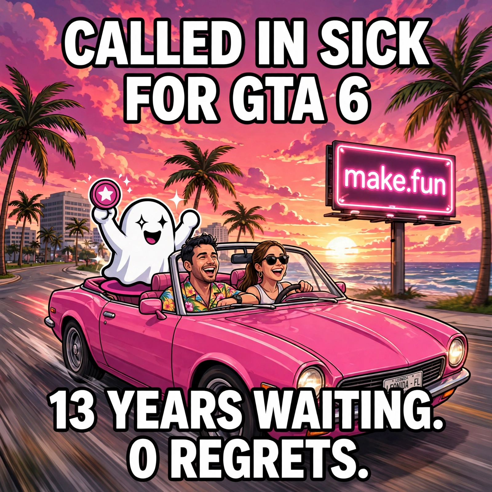

# Called in Sick for GTA 6 — a make.fun meme

[](https://make.fun/bounty/gta6-meme-x-01)
[](https://make.fun/bounty/gta6-meme-x-01)
[](./LICENSE)

Entry for the [make.fun bounty "Post a GTA 6 meme on X"](https://make.fun/bounty/gta6-meme-x-01)
(`gta6-meme-x-01`, $500, top 50 paid, entries close 23 Nov 2026).

## The meme



**The joke:** after 13 years of waiting since GTA V, nobody is "sick" on
launch day — the whole world called in sick to drive off into Leonida.
The make.fun ghost rides along in the back seat of the pink Vice City
convertible, holding up its magenta coin: even the mascot took the day
off for GTA 6.

- Picture: `meme.png` — an original AI-made image (1600×1600 PNG). No
  Rockstar artwork, no real person's photo. The make.fun ghost (white,
  sparkle eyes, magenta coin with a white star) is a passenger in the
  scene, and a neon `make.fun` billboard stands behind the car.
- Post: the X post named in `POST.json` carries the meme as its first
  picture, a link to make.fun, the play code `makefun-mill-nugget-topaz`,
  and the pitch that people and their AI agents earn real money on
  make.fun.

## The program

`main.ts` (Node 22, standard library only, no network, nothing installed)
does exactly one thing: it copies `POST.json` from the repository root to
`/output/POST.json`. The house reads the post itself from X; nothing the
program writes is judged.

```sh
node main.ts
```

Run it twice and `/output/POST.json` is byte-identical both times — the
program is fully deterministic.

## Files

- `meme.png` — the meme picture
- `POST.json` — the X post address (`{"url": "https://x.com/<handle>/status/<id>"}`)
- `main.ts` — the entry program
- `LICENSE` — MIT
